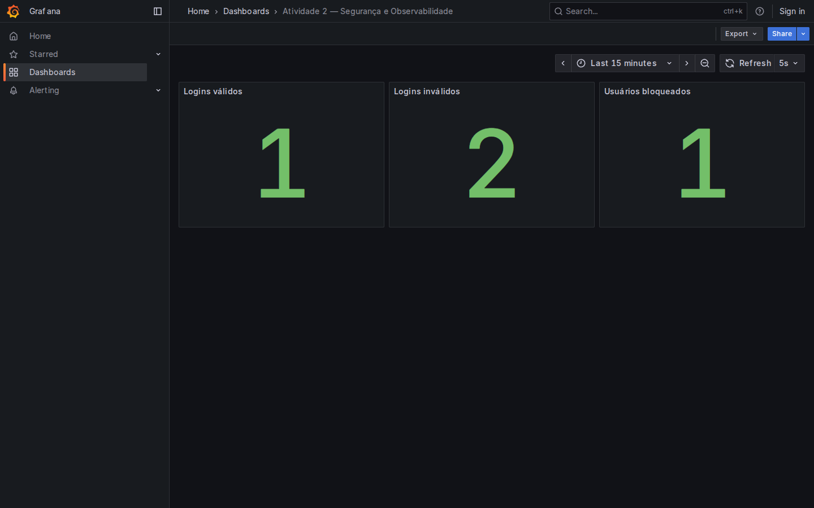

# Atividade 2 — Segurança e Observabilidade

Implementação exclusiva de `MS-AV-02-Segurança-Observabilidade.md`. O enunciado fornecido no ZIP está em `ENUNCIADO.md`. Referência: [especificação da atividade 2](https://github.com/esensato/ms-2026-02/blob/main/MS-AV-02-Seguran%C3%A7a-Observabilidade.md). Não inclui a atividade 1.

## Executar

Requisitos: Docker e Docker Compose. Crie um arquivo `.env` na raiz com valores escolhidos por você:

```dotenv
BOOTSTRAP_USERNAME=
BOOTSTRAP_SENHA=
GRAFANA_USERNAME=
GRAFANA_SENHA=
```

Preencha todos os valores. `BOOTSTRAP_USERNAME` aceita até 100 caracteres e `BOOTSTRAP_SENHA`, até 10, conforme as colunas do SQL. Não publique `.env`.

```sh
docker compose up --build
```

O usuário inicial recebe `ROLE_MANUTENCAO` e `ROLE_ADMIN`, permitindo testar os endpoints protegidos sem acrescentar um endpoint de gestão de roles. Ele é criado apenas se ainda não existir. O cadastro comum não concede essas roles.

- Swagger: http://localhost:8080/swagger-ui/index.html
- OpenAPI: http://localhost:8080/v3/api-docs
- Grafana: http://localhost:3000/d/atividade-2-login (credenciais definidas no `.env`).
- Prometheus: http://localhost:9090

O datasource e o dashboard são carregados automaticamente. O H2 é persistido no volume `login-data`.

Alternativa para executar apenas a API: configure `BOOTSTRAP_USERNAME` e `BOOTSTRAP_SENHA` nas variáveis de ambiente e execute `./mvnw spring-boot:run` (Windows: `mvnw.cmd spring-boot:run`), com Java 17 ou superior. A observabilidade completa usa o Compose.

## Endpoints exigidos

| Método | Caminho | Corpo JSON | Acesso |
|---|---|---|---|
| POST | `/login` | `{"username":"…","senha":"…"}` | Público; 200 válido, 401 inválido ou bloqueado |
| PUT | `/trocarsenha/{userid}` | `{"atual":"…","nova":"…"}` | Público; confere a senha atual no banco |
| POST | `/` | `{"username":"…","senha":"…"}` | ROLE_MANUTENCAO |
| PUT | `/unlock/{userid}` | Sem corpo | ROLE_ADMIN |
| GET | `/` | Sem corpo | ROLE_MANUTENCAO; lista os usernames em JSON |

`userid` corresponde a `username`, pois o SQL fornecido define essa chave e não contém um ID numérico. Os endpoints protegidos usam HTTP Basic; no Swagger, use **Authorize** com as credenciais do usuário que possui a role exigida. A autenticação HTTP Basic e a autorização por roles seguem o exemplo JDBC do README da disciplina.

## Banco e bloqueio

`src/main/resources/schema.sql` mantém `usuarios` e `login_attempts` do enunciado, removendo somente a vírgula final inválida após `updated_at`. As tabelas `users` e `authorities` seguem o exemplo de `JdbcUserDetailsManager` do README da disciplina.

O cadastro usa `JdbcUserDetailsManager.createUser`; a consulta de autenticação foi adaptada para obter a senha de `usuarios` e considerar `login_attempts.locked`. A troca de senha atualiza as duas tabelas de credenciais na mesma transação. A coluna `senha VARCHAR(10)` foi preservada, com comparação em texto como no exercício e `{noop}` no adaptador JDBC.

A segunda falha bloqueia o usuário existente. O bloqueio impede também HTTP Basic. O desbloqueio administrativo zera as falhas e limpa as datas. Como o enunciado não determina reset após login válido, as falhas são acumuladas até o desbloqueio. Uma tentativa para username inexistente conta como login inválido, sem criar um usuário ou um usuário bloqueado.

## Indicadores e Grafana

| Indicador Prometheus | Significado |
|---|---|
| `logins_validos_total` | Total de logins válidos em POST /login |
| `logins_invalidos_total` | Total de logins inválidos em POST /login, incluindo bloqueados |
| `usuarios_bloqueados` | Quantidade atual de usuários bloqueados no banco |

Os contadores de login usam Micrometer e reiniciam com a API. A quantidade de bloqueados é consultada no banco e diminui após desbloqueio.

Dashboard exportado: `observabilidade/grafana/dashboards/login.json`.

O Grafana e o Prometheus foram executados com requisições reais: um login válido, dois inválidos e um usuário bloqueado. A exportação foi obtida pela API do Grafana. As métricas coletadas estão em `evidencias/metricas.prom`.

Print real do dashboard:



## Verificação

```sh
./mvnw clean verify
```

Os 4 testes usam bancos em memória e verificam os cinco endpoints por HTTP, isolamento das roles, bloqueio na segunda falha, desbloqueio, troca de senha, métricas, OpenAPI e Swagger. Também verificam senhas vazias, limites de cadastro, consulta parametrizada e duas falhas simultâneas. As credenciais de teste existem somente nos bancos temporários dos testes. Os resultados estão em `evidencias/testes.txt`.

## Entrega

Repositório público: https://github.com/luca-redinnovations/ms_atv_02

O projeto contém o código da atividade 2, o print real do Grafana em `evidencias/dashboard-grafana.png` e o dashboard exportado em `observabilidade/grafana/dashboards/login.json`, conforme o enunciado.
